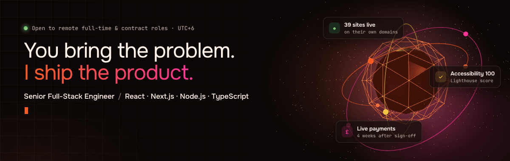

  

<h2 align="center">Hi, I'm Chand — a Senior Full-Stack Engineer</h2>

  I build and ship production web apps end to end: product, backend, payments, deployment and the monitoring after. 
  Team lead at a UK web agency · Based in Sylhet, Bangladesh (UTC+6)

  
  
  

---

### What I do

- **Full-stack product work** — Next.js, React and TypeScript on the front; Node.js / Express APIs, PostgreSQL and MongoDB behind them.
- **Payments & integrations** — Stripe checkout, subscriptions and webhook handling; third-party APIs and background workers on Redis queues.
- **AI features** — LLM pipelines with the Claude API (chunking, retries, fallback providers, cost control) and AI-assisted engineering with Claude Code and Cursor.
- **SEO, performance & accessibility** — server-rendering for search and AI crawlers, Core Web Vitals, Lighthouse accessibility 100.
- **Shipping & running it** — I deploy and operate everything I build on Vercel, Railway and Cloudflare, with CI on GitHub Actions.
- **Leading a team** — I review code, plan delivery and mentor developers on a distributed team.

### By the numbers

| 39 | 100 | 4 weeks |
|:---:|:---:|:---:|
| production sites live on their own domains | Lighthouse accessibility score | from design sign-off to live card payments |

### Tech stack

  

  

Also: Stripe · Shopify · Webflow · Playwright · Claude API · Cursor

### Selected work

Most of my work is client code in private repositories, so here are the live products instead:

| Project | What I built |
|---|---|
| [**Crafted Routes**](https://craftedroutes.co.uk) | Booking site with live Stripe card payments, launched 4 weeks after design sign-off |
| [**Siyar Institute**](https://siyarinstitute.org) | Multilingual research platform (EN / AR / ID / UR) — Claude-powered translation pipeline, SSR fixes so search and AI crawlers can read it |
| [**Daily Wird**](https://dailywird.app) | A daily reading web app |
| [**As-Subah Outreach**](https://assubahoutreach.com) | Charity platform — moved from spreadsheets to online recurring giving in 8 weeks |
| [**GroundRoots Initiative**](https://groundroots.org) | Charity site — Lighthouse accessibility 100, mobile performance 71 → 86 |
| [**Holborn Travel Clinic**](https://holborntravelclinic.co.uk) | Treatment pages and online booking across 3 domains |
| [**Sharifi Legal**](https://sharifilegal.co.uk) | 24-page law-firm site with forms that qualify cases before the first call |

➡️ **All 39 projects:** [chandrahman.site](https://chandrahman.site)

### Activity

  

---

<i>You bring the problem. I ship the product.</i>

